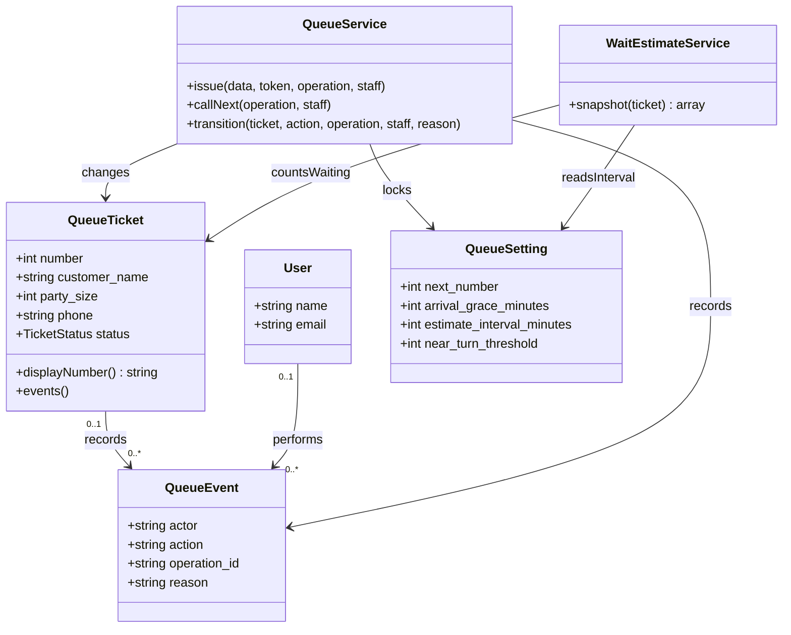
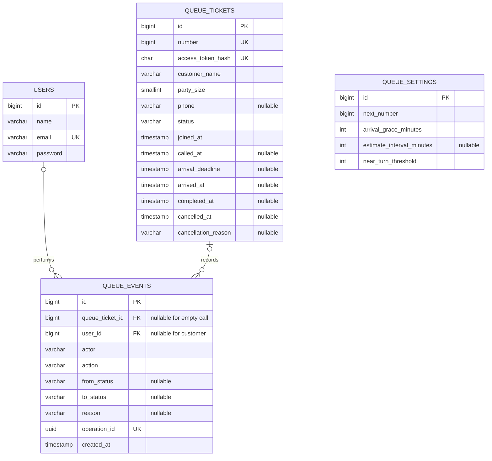
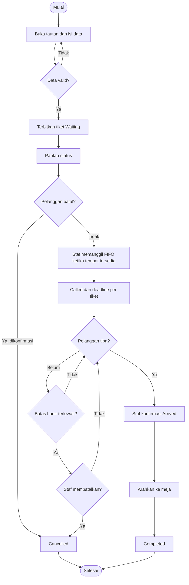
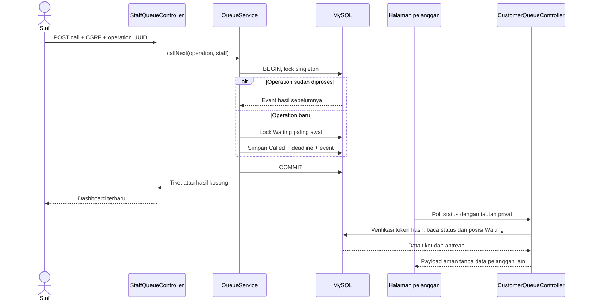

# Rancangan sistem

## Arsitektur

Browser -> Laravel routes/controllers/FormRequest -> QueueService / WaitEstimateService -> Eloquent -> MySQL/InnoDB. Blade melakukan escaping; JavaScript hanya stepper, dialog, polling, dan tampilan waktu. CSS/JS dilayani langsung dari public, tanpa build frontend atau SPA.

StaffAuthController mengelola session login/logout. CustomerQueueController memverifikasi hash tautan akses. StaffQueueController memerlukan auth. QueueService mengunci singleton settings sebelum mengubah nomor atau status; event ditulis dalam transaksi yang sama. operation_id unik memungkinkan retry mengembalikan hasil yang sama, termasuk hasil call kosong.

## Class diagram

## ERD dan migration

Migration adalah sumber tepat tipe, panjang, nullability dan constraint. Index (status, number) melayani FIFO. Tidak ada Customer/Restaurant tambahan tanpa kebutuhan akun atau multi-restoran. Tabel cache/jobs/session bawaan Laravel tidak menjadi entity domain. Singleton settings dibuat oleh migration.

Lifecycle: Waiting -> Called -> Arrived -> Completed; Waiting/Called dapat dibatalkan pelanggan, staf dapat membatalkan state aktif dengan alasan yang diizinkan. Cancelled dan Completed terminal. No-show hanya Called pada/setelah deadline. ETA hanya untuk Waiting dan tidak menghitung Called.

## UI dan endpoint

- `/`: registration; `/antrean` POST: issue.
- `/tiket/{token}`: private status; `/status` suffix: safe JSON; `/batalkan` POST: confirmed cancellation.
- `/staf/masuk`: login; `/staf`: dashboard; `/staf/status`: authenticated fragment polling.
- Staff add/call/settings/transitions are authenticated POST routes with CSRF.

Figma join 5:37, waiting 5:81, dashboard 5:121, called 5:221, cancel 5:259, arrived 5:512. Reused visual tokens: ink #17324D, teal #087E8B, pale #E9F5F4, background #F5F8FA. Actual Figma icons are stored under public/design. Forms use semantic HTML, focus outlines, labelled controls, and native dialog confirmation. The dashboard supports several pending arrivals instead of one current-call slot.

## Proteksi dan pengecualian

No public staff registration. Customer token 256-bit, SHA-256 stored, no sequential-number lookup. Ticket pages use private/no-store and no-referrer. Public status JSON omits names and phone. Secrets are excluded from flashed input. Unique operations and lock ordering protect simultaneous actions. Overdue remains manual; empty queue, stale transitions, invalid links, reconnect failures and duplicate submissions have explicit handling.

## Deskripsi use case awal

| Use case | Aktor / prasyarat | Alur utama | Pengecualian / hasil |
| --- | --- | --- | --- |
| Ambil nomor | Pelanggan, halaman registrasi | Isi nama/jumlah orang, telepon opsional; kirim; sistem memberikan tiket | Isian tidak valid ditolak; retry tidak membuat tiket kedua |
| Pantau antrean | Pemegang tautan privat | Buka tiket; lihat posisi/status; polling memperbarui informasi | Link invalid 404; koneksi gagal menampilkan status stale |
| Batalkan sendiri | Pelanggan, Waiting/Called | Pilih batal; konfirmasi; nomor keluar dari antrean | Cancelled terminal; kembali harus ambil nomor baru |
| Masuk/keluar | Staf dengan akun yang diprovisikan | Login, session baru; logout mengakhiri session | Kredensial salah ditolak; rate limit terpisah dari polling |
| Tambah pelanggan | Staf login | Isi form yang sama; sistem menambahkan di akhir FIFO | Validasi dan duplicate-submit sama dengan pelanggan |
| Panggil berikutnya | Staf login, tempat tersedia menurut staf | Sistem mengunci queue, mengambil Waiting paling awal, menyimpan Called dan deadline | Empty result aman untuk retry; Called sebelumnya tetap berlaku |
| Konfirmasi kedatangan | Staf, Called | Verifikasi orang di lokasi, ubah ke Arrived | State stale ditolak; overdue dapat diterima sebelum pembatalan |
| Selesaikan | Staf, Arrived | Arahkan ke meja lalu tandai Completed | Tidak boleh langsung menyelesaikan Waiting/Called |
| Batalkan/lewati | Staf, tiket aktif | Pilih alasan, konfirmasi, simpan Cancelled | No-show hanya pada/setelah deadline; tidak ada pemulihan posisi |

## Activity flow

## Sequence panggilan dan pembaruan status

Diagram awal ini perlu dipindahkan/ditinjau dalam format presentasi yang sesuai rubrik. Activity dan sequence tidak menggantikan diagram UML use-case formal. Interaksi Figma masih perlu dihubungkan untuk prototype klik.
